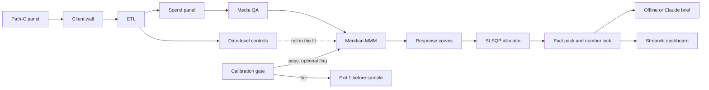

# MMT&MMM — marketing mix modeling with a Bayesian MMM

martech-mmm-ai-allocator is a marketing measurement workspace. Google Meridian estimates incrementality, and the figure you read is incremental lift. Adstock and saturation shape the response curves. Media mix optimization turns those curves into a budget allocation. Unified measurement here also includes touchpoint calibration. The executive dashboard is where you try a split.

You set one total budget and a floor and ceiling for each media partner. The allocator recommends a mix aimed at a higher incremental KPI. Charts show the curves, where extra spend flattens, and how the mix moves versus an equal split. A short commentary ships with the page. A live Claude rewrite is optional and is the only step that needs an API key.

The data is synthetic Path-C. Figures are incremental KPI, not currency and not client revenue. This repo does not claim ROI dollars or a guaranteed lift. Meridian channel rank versus that synthetic ground truth is still open (Spearman about −0.6). Details: [`docs/learnings/story-201-meridian.md`](docs/learnings/story-201-meridian.md).



Controls are not in the Meridian fit yet. Default client is `pathc`. Industry separation is this filesystem wall, not a second model. The calibration gate runs only when the spike is given `--calibration`. A failing gate exits 1 before `sample_prior`. Omitting the flag keeps `PriorDistribution()`. Full diagram: [`.archify/architecture-mmt-sprint3-20261020-215729/architecture-mmt-sprint3.html`](.archify/architecture-mmt-sprint3-20261020-215729/architecture-mmt-sprint3.html).

## 5-minute quickstart

```bash
cd "/home/mario/dev/MMT&MMM"
conda env create -f environment.yml
conda activate mmt-mmm
python -m pytest tests/ -q
streamlit run app/streamlit_app.py -- --client_id pathc
```

**[Test the tool (no statistics background)](docs/how-to-test.md)**

Walkthrough: add a 2-minute Loom URL here.

Released under the MIT license (`LICENSE`).

<!--
GitHub description: Bayesian marketing mix modeling, incrementality, and media-budget allocation with Google Meridian.
Topics: marketing-mix-modeling, bayesian-mmm, incrementality, media-mix, budget-allocation, google-meridian, marketing-measurement
-->

## Product (short)

- Replaces platform-biased attribution windows with a unified measurement layer
- Learns decay, saturation, and incremental lift for segmented campaigns across the funnel
- Continuous Bayesian updating from new performance data (statistics, not LLMs doing the math)
- Agentic AI layer orchestrates Python optimization scripts and explains outputs for C-suite decisions

## Local workspace

| Item | Value |
| --- | --- |
| Path | `/home/mario/dev/MMT&MMM` (quote the `&` in shells) |
| Origin | [MMT-MMM](https://cursor.com/codebase/mario-mu-oz-dev/MMT-MMM) (private) — remote `origin` |
| GitHub | [martech-mmm-ai-allocator](https://github.com/marioenriquemuo/martech-mmm-ai-allocator) (public) — remote `github` |
| Working branch | `sprint-3-exogenous-multitenant-mmt` — **Sprint 3 — Exogenous Controls, Multi-Tenant Architecture & MMT Calibration** (goal: exo traffic/holidays/quincenas/inventory, multi-tenant isolation, MMT geo-experiment anchors). Tip: `git push origin HEAD && git push github HEAD` |
| Secrets | `Secret/` — **gitignored; never commit** |
| Python env | Miniconda env `mmt-mmm` via `environment.yml` |
| Docker | Image (`Dockerfile`) for the dashboard and allocator. Full Meridian MCMC is a conda/CPU job. The first image build is heavy. |

## Local setup (Miniconda)

Requires [Miniconda](https://docs.conda.io/en/latest/miniconda.html) (or micromamba) on `PATH`. On Mario’s machine: `~/miniconda3` (`conda` 26.x).

```bash
cd "/home/mario/dev/MMT&MMM"

# Create the env (once)
conda env create -f environment.yml

# Activate
conda activate mmt-mmm

# Verify key imports (pymc + Meridian both expected after env update)
python -c "import numpy, pandas, scipy, sklearn, pymc, arviz, matplotlib, plotly, yaml, pydantic, pandera, pyarrow; print('ok', pymc.__version__)"
python -c "import pymc, meridian; print('pymc', pymc.__version__, 'meridian', getattr(meridian, '__version__', 'ok'))"
```

Recreate or refresh deps: `conda env update -f environment.yml --prune` (pins `google-meridian==2.1.0` via pip).

**Tested Meridian combo:** `google-meridian==2.1.0` + `arviz` 0.19.x + `matplotlib` 3.10.x (`matplotlib<3.11` in `environment.yml` — arviz 0.19 breaks on matplotlib 3.11+ `style.core` removal) + `pymc` 6.x.

Env name and Python pin: `mmt-mmm` / 3.12 (see `environment.yml`, `.python-version`).

## Docs for humans and agents

| File | Role |
| --- | --- |
| `README.md` | This overview + setup |
| `CLAUDE.md` | Project brief and conventions for Claude/Cursor |
| `AGENTS.md` | Agent entrypoint: layout, golden rules, skills/rules index |
| `data/raw/DATA_CARD.md` | Raw panel grain, KPI rules, ETL fill rules, STORY-104 QA gate, Meridian week grain |
| `docs/learnings/` | Story learnings + [`open-gaps.md`](docs/learnings/open-gaps.md) registry (Sprint planning) |
| `docs/learnings/story-201-meridian.md` | STORY-201 Meridian spike learnings + **open rank-recovery issue** |
| `docs/sprints/sprint-3.md` | Sprint 3 brief (exogenous controls, multi-tenant, MMT calibration) |
| `docs/how-to-test.md` | Click-through for the dashboard, no statistics background |
| `docs/graphify-archify.md` | Index of graphify knowledge graph + archify diagrams |

## Skills, rules, and PRs

- Shared skills: `~/.cursor/skills/`. Repo skills: `.cursor/skills/` (`mmt-mmm`, `secret-hygiene`, `archify`). See `AGENTS.md`.
- Shared rules: `~/.cursor/rules/`. Repo rules: `graphify`, `secret-hygiene`.
- Sprint 3 work lands on `sprint-3-exogenous-multitenant-mmt`; feature branches `cursor/<topic>-…` when useful
- Push intentional commits to both `origin` and `github`
- Never commit `Secret/`, credentials, or local conda env directories

## Generate synthetic data

STORY-101 Path-C generator (reproducible `seed=42`):

```bash
conda activate mmt-mmm
python -m src.data.generator
```

Writes:

- `data/raw/synthetic_ad_spend.csv` — 728 days × 4 channels (`meta`, `google`, `tiktok`, `tv`)
- `data/raw/ground_truth.json` — planted adstock / Hill / media-scale parameters
- See [`data/raw/DATA_CARD.md`](data/raw/DATA_CARD.md) for long-format semantics, grain, and KPI notes

Columns: `date`, `channel`, `spend` (float USD), `impressions` / `clicks` / `baseline_sales` (non-negative integers).  
`baseline_sales` is the site-wide daily unit KPI **repeated** on each channel row — do not sum across channels.

Committed CSV is locked to `seed=42` after integer post-processing.

```bash
python -m pytest tests/test_generator.py -q
```

## STORY-102 / transforms (done)

**geometric + Weibull adstock + Hill saturation** live in
`src/models/transformations.py`. Path-C DGP imports those helpers (single source of
truth). Validation DoD uses a Plotly Express script — **not** a Jupyter notebook.

**Speed gate:** `tests/test_transformations_perf.py` asserts wall time
&lt; 1s for `geometric_adstock` + `weibull_adstock` + `hill_saturation` on ~730
days × 4 channels (`time.perf_counter`).

```bash
conda activate mmt-mmm
# after env create/update — plotly is in environment.yml (conda-forge)
conda env update -f environment.yml --prune

python -m pytest tests/test_transformations.py tests/test_transformations_perf.py -q
python scripts/plot_adstock_validation.py
# → reports/figures/geometric_adstock_pulse.html
# → reports/figures/weibull_adstock_pulse.html  (two shapes + geometric reference)
# → reports/figures/hill_saturation_curves.html  (K / S response curves)
```

## STORY-103 / ETL (done)

Raw channel-day CSV → aligned date×channel panel → impute → Pandera validate → Parquet.

```bash
conda activate mmt-mmm
conda env update -f environment.yml --prune   # pulls pandera + pyarrow

python -m src.data.etl
# → data/processed/clean_spend.parquet
# → data/processed/exogenous_controls.parquet (STORY-501, one row per date)

python -m pytest tests/test_etl.py -q
```

**Fill rules:** missing media after alignment → **0** (pause / not in export); missing `baseline_sales` → **forward-fill**. Dirty practice export: `tests/fixtures/dirty_ad_spend.csv`. See [`data/raw/DATA_CARD.md`](data/raw/DATA_CARD.md).

## STORY-104 / media QA (done)

After ETL, check that impressions/clicks look believable vs each channel’s recent history. Repair when history exists; **hard-fail** (exit ≠ 0) if anomalies remain unrepaired so Meridian never trains on bad media. Never mutates `spend` or `baseline_sales`.

```bash
conda activate mmt-mmm
python -m src.data.etl          # refresh clean_spend.parquet if needed
python -m src.data.qa           # overwrite clean_spend.parquet; exit 0 or ≠ 0
python -m pytest tests/test_qa.py -q
```

**Artifacts:** overwrite `data/processed/clean_spend.parquet`; optional audit `data/processed/qa_repair_log.csv` (only when repairs ran). Anomaly fixture: `tests/fixtures/anomalous_spend.csv`.

## STORY-201 / Meridian spike (done)

National Google Meridian fit on post-QA `clean_spend.parquet` (weekly grain by default).
Learnings + **open rank-recovery issue**: [`docs/learnings/story-201-meridian.md`](docs/learnings/story-201-meridian.md).

```bash
conda activate mmt-mmm
conda env update -f environment.yml --prune   # pins google-meridian==2.1.0 via pip
python -c "import pymc, meridian; print(pymc.__version__, meridian.__version__)"

python -m src.data.etl
python -m src.data.qa

# Fast adapter / spike-helper tests (no MCMC)
python -m pytest tests/test_meridian_data.py tests/test_model_spike_helpers.py -q

# Smoke: short chains + R-hat peek (warns SMOKE_RHAT_WARN; exit 0 unless --fail-on-rhat)
python scripts/02_model_spike.py --mode smoke

# Fuller DoD (CPU; can take a long time): R-hat < 1.05 gate + artifacts
python scripts/02_model_spike.py --mode full
# → data/clients/pathc/models/metrics.json  (includes recovery_spearman + dod.directional_recovery; not a hard fail)
# → data/clients/pathc/models/posterior_predictive.png
# → data/clients/pathc/models/parameter_recovery.md
```

Adapter: `src/models/meridian_data.py` (KPI=`baseline_sales`, media=`impressions`, spend=`spend`). Weekly KPI is **sum of daily units** (flow aggregation). Override MCMC sizes with `--n-chains` / `--n-adapt` / `--n-burnin` / `--n-keep`. Daily grain: `--freq D` (much slower).

**Open issue:** Meridian iROAS rank (meta&gt;tiktok&gt;tv&gt;google) disagrees with Path-C (tv&gt;google&gt;meta&gt;tiktok); Spearman ≈ −0.6. Status-only for this spike — see the learning doc.

## STORY-301 / budget allocator

Constrained budget optimizer on offline response curves (`scipy.optimize` SLSQP).
Reads Meridian `data/clients/pathc/models/metrics.json` `response_curves.means` (or a synthetic fixture).
**Caveat:** allocator trusts those curves even though Meridian channel-rank recovery vs Path-C is still open ([`docs/learnings/story-201-meridian.md`](docs/learnings/story-201-meridian.md)) — do not treat allocations as Path-C ground truth.

On failure (`solver.success=false` — infeasible bounds/target or post-solve check), `channels` is an empty object `{}` so callers do not read a partial plan.

```bash
conda activate mmt-mmm

# Maximize incremental KPI under a fixed budget (+ bounds)
python scripts/03_allocate_budget.py \
  --curves tests/fixtures/synthetic_response_curves.json \
  --budget 60 --min-spend 5 --max-spend 30

# Or hit a KPI target with minimum total spend
python scripts/03_allocate_budget.py \
  --curves tests/fixtures/synthetic_response_curves.json \
  --target-kpi 20 --min-spend 0

# Meridian metrics → reports/allocation.json
python scripts/03_allocate_budget.py \
  --curves data/clients/pathc/models/metrics.json \
  --budget 100000 --min-spend 0 \
  --out reports/allocation.json

# Teaching plots (Plotly Express HTML)
python scripts/plot_allocation_teaching.py
# → reports/figures/story_301_response_curves.html
# → reports/figures/story_301_allocation_vs_baseline.html

python -m pytest tests/test_curves.py tests/test_allocator.py -q
```

Modules: `src/optimize/curves.py`, `src/optimize/allocator.py`. CLI: `scripts/03_allocate_budget.py`.

## STORY-302 / C-suite brief (step 0–4)

Teaching figures for budget shift, saturation, and KPI lift. The recommended mix is fixed (alpha 27, beta 18, gamma 15) because equal-room on this fixture is 20/20/20 and SLSQP does not leave that point.

`--offline` fills the brief from the allocation JSON. Without that flag the CLI calls Anthropic (`claude-sonnet-4-5`, override with `--model`) and forces the `emit_brief` tool. The fact-pack lock keeps structured spend, delta, KPI, and saturation flags exact. Headline and bullets may round a fact-pack number (for example lift `0.12`). A number that is not that rounding is rejected and the brief file is not written. Headline and bullets call figures incremental KPI and spend units (no `$`, dollars, or revenue).

**Caveat:** Meridian channel rank vs Path-C is still an open issue — do not treat the brief as Path-C ground truth. Numbers are incremental KPI, not revenue dollars.

Key: `ANTHROPIC_API_KEY`, else one line in gitignored `Secret/anthropic_api_key`. The CLI does not print the key.

```bash
conda activate mmt-mmm
python scripts/plot_story_302_concepts.py
# → reports/figures/story_302_budget_shifts.html
# → reports/figures/story_302_saturation.html
# → reports/figures/story_302_kpi_lift.html

python scripts/04_csuite_brief.py \
  --allocation tests/fixtures/story_302_allocation.json --offline

python scripts/04_csuite_brief.py \
  --allocation tests/fixtures/story_302_allocation.json
# live; writes reports/csuite_brief.json only after the number lock passes

python -m pytest tests/test_csuite_facts.py tests/test_csuite_brief.py -q
```

Modules: `src/report/facts.py`, `src/report/schema.py`, `src/report/brief.py`. Fixture plan: `tests/fixtures/story_302_allocation.json`.

## STORY-401 / Streamlit dashboard

Local dashboard. The total budget and each partner’s min % and max % (0–100) have a slider and a number box on the same value. A partner’s min cannot pass its max, and the minimum percents cannot add up past 100 (a change that would pass 100 keeps only the room left). Each max stays at most 100; the maxes may sum past 100. Those percents are spend bounds (`min_spend = percent / 100 × budget`). `optimize_budget` chooses the investment. The charts compare the equal-room baseline with that recommendation. If the bounds are infeasible, the page shows the allocator error and does not call Claude. **Update insights** is the only control that calls Claude (`render_live` on the current fact pack). Before that click, commentary is the offline brief. Changing a slider or number clears the cached live brief.

The sidebar curve file defaults to `data/clients/pathc/models/metrics.json` when that file exists, otherwise `tests/fixtures/synthetic_response_curves.json`. The budget slider range comes from that file’s spend knots.

**Caveat:** numbers are incremental KPI, not revenue dollars. Meridian channel rank vs Path-C is still an open issue — do not treat the dashboard as Path-C ground truth.

Key: `ANTHROPIC_API_KEY`, else one line in gitignored `Secret/anthropic_api_key`. The app does not print the key.

```bash
conda activate mmt-mmm
cd "/home/mario/dev/MMT&MMM"
streamlit run app/streamlit_app.py -- --client_id pathc

python -m pytest tests/test_dashboard_view.py -q
```

The dashboard is not a static HTML file (`streamlit run app/streamlit_app.py` serves it); static HTML that can be opened directly stays the archify diagram and `reports/figures/*.html`.

Math: `src/dashboard/view.py` (pytest, no browser). `app/streamlit_app.py` is layout only.

## STORY-501 / exogenous controls

`python -m src.data.etl` writes `data/processed/clean_spend.parquet` (date × channel) and `data/processed/exogenous_controls.parquet` (one row per date). `baseline_sales` stays on the spend panel. Do not sum control columns across channels.

Columns on the controls matrix: `organic_seo_clicks`, `brand_search_volume`, `crm_email_volume`, `holiday_flag`, `quincena_flag`, `price_drop_flag`, `inventory_oos_flag`.

`brand_search_volume` can be a mediator (media can cause brand search). `inventory_oos_flag` can be a result of demand. These columns are aligned for later conditioning. They are not in the Meridian fit. Priors, holdout, and `GAP-201-RANK` stay open ([`docs/learnings/open-gaps.md`](docs/learnings/open-gaps.md)). Grain: [`data/raw/DATA_CARD.md`](data/raw/DATA_CARD.md).

```bash
conda activate mmt-mmm
python -m src.data.etl
# → data/processed/clean_spend.parquet
# → data/processed/exogenous_controls.parquet
```

## STORY-502 / client wall

Default client is `pathc` (`config/clients.yaml`). No `--client_id` still reads and writes today's Path-C files. `pathc` keeps `data/raw`, `data/processed`, and `reports`; models go to `data/clients/pathc/models`. Client `wellness` uses only `data/clients/wellness/` (`raw`, `processed`, `models`, `reports`). A few-row fixture lives in that raw tree. Regions are labels. This wall is the industry separation, not a second model.

```bash
python -m src.data.etl --client_id pathc
python -m src.data.qa --client_id pathc
streamlit run app/streamlit_app.py -- --client_id pathc
```

## STORY-503 / geo-experiment prior

`python -m src.models.calibration` reads that client's `raw/calibration/geo_experiment.json` and writes `reports/calibration_delta.json`. For `pathc` those paths are `data/raw/calibration/geo_experiment.json` and `reports/calibration_delta.json`. National `roi` bounds become a log-normal `roi_m` prior. A `bogota` row does not move the national prior. Wellness has no experiment file, so its report leaves every channel on the default prior. The command does not sample a posterior. The fixture numbers are not Path-C ground truth, and `GAP-201-RANK` stays open.

The spike gate runs only with `--calibration`. `build_report` must pass before `sample_prior`: each calibrated channel's central interval stays inside the experiment bounds, and its scale is tighter than the default prior. A miss prints the reason and exits 1. Meridian is not built. Omitting `--calibration` keeps `PriorDistribution()`.

```bash
conda activate mmt-mmm
python -m src.models.calibration
# → reports/calibration_delta.json

python scripts/02_model_spike.py --mode smoke \
  --calibration data/raw/calibration/geo_experiment.json
# omit --calibration to keep PriorDistribution()
```

## Stack direction

Python Bayesian MMM (`google-meridian` + scientific stack in `environment.yml`, the supported install). Full Meridian MCMC is a conda/CPU job. The Docker image is for the dashboard and allocator, and the first build is heavy.
